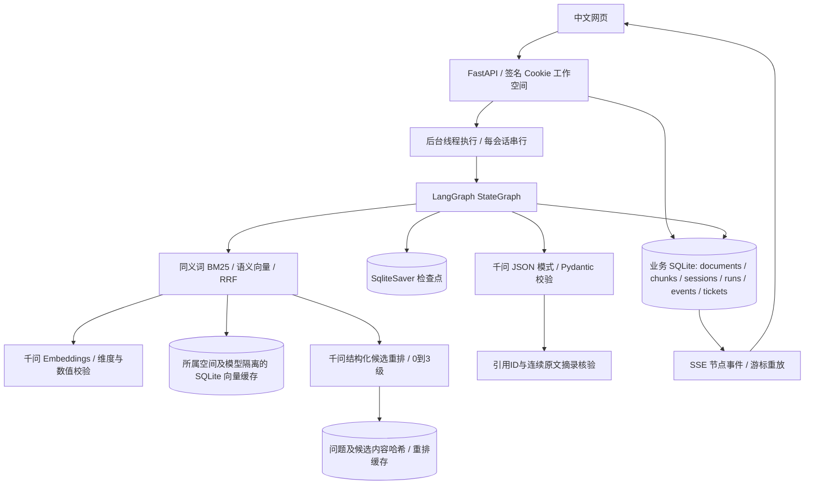
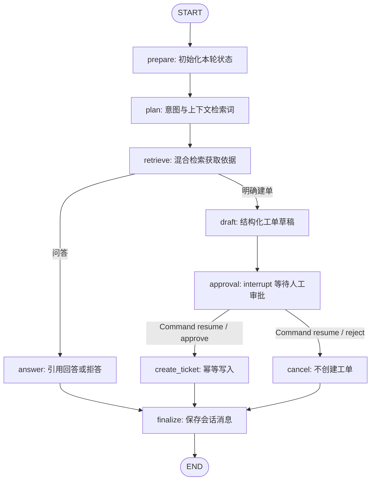

# 架构与恢复机制

v0.3在混合召回后增加`QwenReranker`，按能否回答问题分级，校验完整候选索引，保留2/3级片段；失败时返回RRF结果。回答再检查连续原文摘录。完整评测见[排序与答案质量报告](RANKING_AND_ANSWER_QUALITY.md)。

v0.2 增加 `HybridRetriever`：文档与查询经真实千问向量接口转换，按所属空间和模型配置持久缓存，与同义词 BM25 排名进行 RRF 融合。完整参数及评测见 [检索改进报告](RETRIEVAL_IMPROVEMENTS.md)。审批、恢复与幂等链路沿用第一版设计。

## 请求链路

## 图编排

状态包含所属空间、会话、运行、问题、意图、检索词、资料、引用、草稿和审批结果。`messages` 使用按消息 ID 合并的 reducer，同一节点恢复执行不会重复追加消息。每个会话以 `thread_id=session_id` 保存检查点；图执行使用 `durability="sync"`。

`plan`、`answer`、`draft` 调用真实千问。意图不依靠网页模拟：普通问答经过模型理解，明确创建工单时路由到审批分支。首页建单卡片提供显式 `ticket` 模式；接口也支持 `auto` 和 `answer`。

## 检索与引用

1. 上传时限制文件类型、大小和提取内容规模，仅保存解析出的文字。文件名去除目录路径，内容 SHA-256 对同一工作空间去重。
2. Markdown 按标题拆分；长片段按 760 字窗口、620 字步长切片；PDF 保留页码。
3. 英文和数字按词切分，中文使用字符二元组，过滤常见停用词。关键词路径做全角归一化和同义词扩展，BM25 加标题权重，评分门槛为 2；精确标题查询另加权，支持小文档库。
4. 混合模式以 256 维归一化向量计算余弦相似度，默认门槛 0.45；两路各取最多 12 条，经RRF（常数60）融合至多24条去重候选；默认由千问重排，保留直接或部分支持答案的片段，返回最多4条。向量故障降级关键词；重排故障保留RRF。
5. 检索只加载当前所属空间的片段及向量。问题理解结合最近会话；重排时同时提供原问题和上下文补全检索词，避免短检索词丢失具体事实要求。非重排查询没有命中时再尝试原问题；重排明确过滤为无依据时直接拒答。
6. 模型返回`answer`、`citation_ids`和`supporting_quotes`。程序要求ID来自本次检索，每个引用有至少8字符的连续原文摘录，按NFKC及空白归一化核验；伪造摘录或缺失摘录阻止输出，没有引用则拒答。网页可展开摘录。点击引用时，API 再校验所属空间并提供原文。

重排缓存按所属空间隔离，键包含接口、聊天模型、任务指令、完整问题和候选ID/标题/内容；数据库只保存哈希及索引等级，每空间最多256条，按写入时间淘汰。文档删除时清理该空间的重排缓存。模型或候选内容变化会重新计算，损坏缓存会修复。

门槛和窗口是当前演示数据上的默认值，不是通用最优参数。RRF 只融合排名，不证明片段含有答案；引用 ID 正确也只证明来源存在，语义忠实度仍需评测。

## 三层重复保护

| 层级 | 实现 | 防止的问题 |
| --- | --- | --- |
| 请求 | 会话内 `request_id` 唯一；相同 ID 和内容返回原任务，不同内容返回 409 | 网络重发产生第二个任务 |
| 会话 | SQLite 事务认领状态；同一会话处理中、待审或出错时阻止新任务，后台按会话加锁 | 两个任务互相覆盖图状态 |
| 副作用 | 工单 `operation_id=run_id` 唯一，`INSERT OR IGNORE` 后查询已有记录 | 工单写入后进程中断，恢复时再写一张 |

图检查点和业务库是两个 SQLite 文件，不构成跨库事务。因此副作用必须有独立幂等键。测试专门模拟“工单已经提交，节点随后异常”，再恢复执行，确认工单编号及数量不变。

## 审批、失败与恢复

- `approval` 节点调用 LangGraph `interrupt`，不写工单。待审草稿与会话图状态持久保存，前端显示编辑表单。
- 审批接口校验当前状态和所属空间，再保存结构化决定。恢复时通过 `Command(resume=decision)` 继续；重复提交相同决定不会重复执行。
- 短暂网络错误、429、502、503、504 由 LangGraph `RetryPolicy` 最多尝试两次；其他模型错误直接保存为可恢复状态。
- 服务启动时，把残留的 queued/running 任务标记为可恢复错误。用户点击“从检查点继续”，已完成节点的状态被复用；失败节点可能重执行，因此消息与写入分别去重。
- 已处于待审状态的任务重启后保持待审，审批恢复不需要重新向千问生成草稿。

这些保证面向单进程本地应用。多进程同时启动会触发互相恢复、共享任务认领等问题，当前不支持。

## 事件与用量

业务事件有自增 ID，SSE 接受 `after` 参数及浏览器自动重连的 `Last-Event-ID`，从较大的游标后继续发送；浏览器对事件 ID 再去重。结束时发送 `done`，随后重新读取持久快照。

用量来自模型响应的 `usage.total_tokens`，不是字符估算。耗时采用本地调用计时；界面“模型耗时”是模型请求耗时累计，不包括人工审批等待。未成功返回用量的请求不计入 tokens，所以记录不能替代供应商账单。

## 归属与数据处理

会话 Cookie 使用持久签名密钥、HttpOnly 和 SameSite=Strict。业务查询校验所属空间，检查点读取前也检查会话归属。API Key 仅由后端加载，不包含在模型配置响应或错误正文中。HTML 内容通过 `textContent` 展示，来源文本不能执行脚本；模型输入将文档指令视为数据。

当前没有账号身份认证；持有有效 Cookie 仍能访问对应工作空间。检查点、事件和文档包含原始业务内容，需要按资料敏感程度管理。对外部署前需要补齐身份系统、资源配额、数据库及任务协调，不能直接把本地隔离宣称为企业权限体系。
