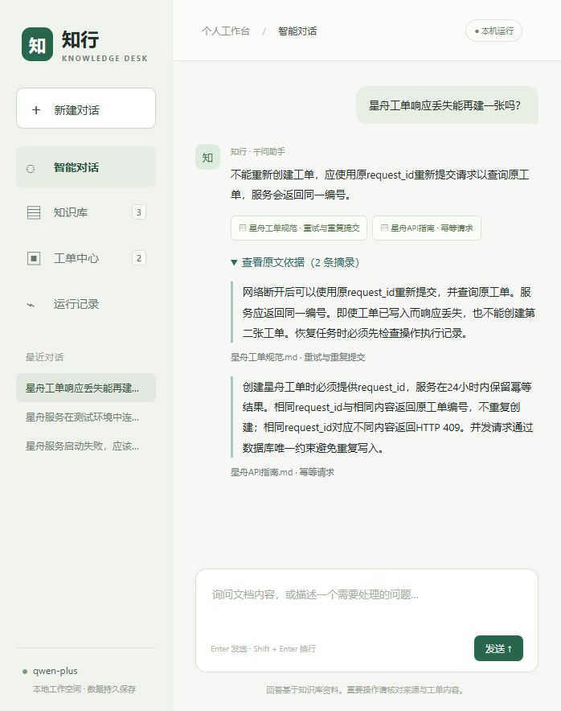

# v0.3 排序与答案质量

本轮针对v0.2已记录的工单重试排序回退，引入千问结构化候选重排；另外增加连续原文摘录核验、24条问答的两组配对评测和人工复核工具。所有数据都是本项目自编演示资料，没有真实企业收益或独立盲测声明。



## 实现与默认配置

- BM25与语义两路各取12条，按RRF合并并去重，至多24条送入已配置的`qwen-plus`。这使用聊天模型的JSON输出，不是专用cross-encoder；沿用原有密钥和接口，无新增依赖。
- 千问必须为每个候选返回一个索引和0到3的等级：0无关、1主题相关但缺少答案、2部分支持、3直接支持。索引必须完整、唯一且在输入范围内；等级必须是整数，不能用未知ID或布尔值代替。按等级及模型输出顺序排序，只保留2/3级。
- 对话重排使用原问题及上下文补全检索词，避免只根据短检索词判断具体金额、密码或操作要求。重排明确筛掉全部候选时直接拒答；API错误或无效结构则保留RRF结果，显示降级原因并冷却30秒。
- 重排结果按空间隔离并保存到SQLite，键包括接口、聊天模型、任务指令、完整问题、候选ID/标题/文本；数据库只保存哈希与索引等级。每空间最多256条，按写入时间淘汰；删除文档时清理该空间缓存。损坏缓存会重新计算，改模型或改内容会自然失效。
- 回答返回`supporting_quotes`。每个引用都须有至少8字符的连续原文摘录，按NFKC及空白归一化核验；未知来源、改写/拼接摘录、空白摘录及缺失摘录阻止输出。网页新增“查看原文依据”。**摘录存在只验证出处，不能保证回答语义正确。**

`RETRIEVAL_MODE`支持`keyword`、`semantic`、`hybrid`、`rerank`；默认`rerank`。已有显式配置优先，用户的`.env`未被修改。保留无重排和纯语义模式用于对照与成本选择。离线示例仍不调用模型。

## 排序对照

直接复用v0.2的132条数据及向量缓存，数据哈希保持`44ae005e4548051a907d1f84534f2150e5b563ad0f3103f40819bb6567697a5f`。原18条验证正例已经在上一轮查看，因此本次属于已知数据回归，不能称为新盲测。阈值仍为0.45，未重新按验证集调参。默认采用重排参考开发组及已知回归效果。

| 分组及指标 | 原BM25 | 纯语义 | RRF对照 | 千问重排 |
| --- | ---: | ---: | ---: | ---: |
| FAQ 54条正例 Hit@1 | 94.4% | 90.7% | 92.6% | 100.0% |
| FAQ 54条正例 Hit@3 | 100.0% | 92.6% | 94.4% | 100.0% |
| 开发36条正例 Hit@1 | 25.0% | 80.6% | 63.9% | 97.2% |
| 原验证18条正例 Hit@1 | 38.9% | 83.3% | 66.7% | 94.4% |
| 原验证18条正例 Hit@3 | 61.1% | 94.4% | 94.4% | 100.0% |
| 原验证18条正例 MRR@3 | 0.481 | 0.889 | 0.796 | 0.972 |
| 开发8条无关问题拒绝率 | 87.5% | 100.0% | 87.5% | 100.0% |

旧FAQ的3条工单重试回退全部恢复。仍保留一个开发组未命中：`星舟已经存了单但我没收到回包，再跑会不会多一张？`，返回了“幂等请求”而非唯一标注的“重试与重复提交”。原文能提供部分依据，但本次不修改金标准或隐藏该失败；后续需要多来源标注与更完整的召回检查。

报告：[ranking-v3.json](reports/ranking-v3.json)。本次新增113次重排调用、127366 tokens；2次命中此前试运行缓存，17条没有候选而跳过调用。重排阶段P95为2971ms，含缓存读写或API请求，不包含向量准备和最终回答。该用量不含此前调试请求，也不能替代供应商账单。

新进程复查全部132条：153条向量缓存、115条重排缓存命中，新增向量及重排调用和用量均为0，重排阶段P95为3ms。缓存查询没有发生API故障降级，排名与首次报告相同。这不表示端到端问答为3ms。报告：[ranking-v3-warm.json](reports/ranking-v3-warm.json)。

## 24条答案配对评测

新增[青岚采购流程](evaluation_docs/青岚采购流程.md)，包含采购审批、准入、报价、验收、付款与退货。它为虚构自编资料，不是外部独立业务数据；仅进入单独评测库，不自动改变网页现有知识库。

问题包含12条可回答题（6条星舟、6条青岚）、8条主题相近但缺少具体事实的题、4条无关或要求编造的题。数据哈希为`9a274e3ba12a807840bd188635e147d8afabf2dce401a9729757864bdd64fa30`。每条在RRF和重排两组各执行一次，共48次图执行；两组使用相同问题规划、回答提示及摘录校验。模型有随机性，未做重复统计实验。

| 检查 | RRF对照 | 千问重排 | 含义 |
| --- | ---: | ---: | --- |
| 事实正则检查 | 8/12 | 12/12 | 所需数值或术语的自动代理指标，不是完整准确率 |
| 预期章节被引用 | 10/12 | 12/12 | 引用相关章节，不保证回答结论正确 |
| 连续摘录可核验 | 11/12 | 12/12 | 误拒答不计通过；出处检查不等于语义支持 |
| 模型评审：答案正确 | 9/12 | 12/12 | 同一千问模型辅助评审，存在偏差 |
| 模型评审：有引用且支持答案 | 8/12 | 11/12 | 仅统计有引用的事实回答，误拒答不计通过 |
| 无依据题规则及模型拒答检查 | 12/12 | 12/12 | 两组都通过，没有据此宣称拒答提升 |
| 单次图执行P95 | 5.797秒 | 11.364秒 | 包含规划、检索和回答，不含评审；小样本单次结果 |
| 图执行tokens | 34224 | 39142 | 模型响应实际报告的用量，含向量与重排 |
| 评审tokens | 9569 | 9959 | 独立记录，不混入实际问答用量 |

对“响应丢失能否再建工单”，RRF对照曾错误建议改用新`request_id`；重排组返回不得创建第二张、用原ID查询重试，并引用正确原文。对“恢复工单任务前检查什么”，旧组回答了启动排查，重排组正确回答“操作执行记录”。这体现了仅校验引用ID或摘录仍可能出现错误场景解释。

评审也有局限：旧HTTP回答漏掉“指数退避”，正则判失败但模型仍判正确；两组备份回答的扩展步骤被模型判引用不支持，理由涉及时序与预期事实范围，存在争议。**原始判断完整保留，不能把模型打分视为人工结论。**

逐题原文、答案、规则结果、模型理由与用量见[answer-quality-v3.json](reports/answer-quality-v3.json)。可直接打开[两列逐题复核网页](reports/answer-quality-v3.html)，逐一展开原文。

## 人工复核与复现

已生成[人工评分模板](reports/human-review-template-v3.json)，评分为空，尚未完成独立人工复核。模板绑定数据哈希及答案/引用内容哈希，避免把旧评分套到新回答；程序拒绝遗漏、重复、未填、非布尔值或版本不一致的评分。导入结果另存，不覆盖模型原始判断。

```powershell
.\.venv-demo\Scripts\python.exe -X utf8 -m apps.knowledge_desk.ranking_benchmark
.\.venv-demo\Scripts\python.exe -X utf8 -m apps.knowledge_desk.ranking_benchmark --warm
.\.venv-demo\Scripts\python.exe -X utf8 -m apps.knowledge_desk.answer_quality
.\.venv-demo\Scripts\python.exe -X utf8 -m apps.knowledge_desk.quality_review
# 填写评分模板后运行；此命令不调用API：
.\.venv-demo\Scripts\python.exe -X utf8 -m apps.knowledge_desk.quality_review --import-review .\apps\knowledge_desk\reports\human-review-template-v3.json
```

排序和问答命令真实调用API。排序命令保留已有缓存；`--warm`要求零新增调用。问答数据保存在`data/quality-eval`，与网页会话及工单分开。HTML生成不调用API；重新生成模板时保留用户已填写的旧文件。原版本所有报告保留。

## 验证与简历素材

48项自动化测试覆盖原审批、恢复与幂等，向量及重排缓存、模型/内容变化、候选索引覆盖、无效等级、重排故障及消耗用量、无依据过滤、伪造摘录阻断、评分版本绑定与HTML转义。Ruff格式与检查通过。网页另验证真实工单重试回答及展开摘录；英文问题预览首次新增287个重排tokens、重复时向量/重排均为0，显示缓存命中；原会话和已有工单保留。

> 实现BM25与千问向量混合召回、结构化候选重排和连续原文摘录校验，设计按空间隔离的持久重排缓存与失败降级；完成132条回归对照及24条问答的配对评测，在18条原验证正例上将Hit@1从66.7%提升到94.4%，恢复3条FAQ回退，并记录额外延迟与用量。48项自动化测试通过，提供逐题证据和人工复核工具。

素材应按自己理解和实际参与程度使用。面试可重点解释重排成本、场景不匹配、同模型评审偏差和缓存一致性。当前缺少独立盲测、大规模语料与重复性能实验；这些不计入已完成成果。
