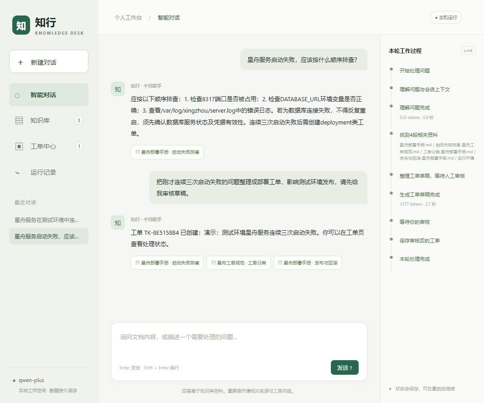

# 知行 · 知识与工单助手

这是基于 LangGraph 的应用项目：把文档问答、故障工单和人工审批串成可恢复的工作流。接入项目根目录 `.env` 中配置的千问，提供中文网页界面。

项目适合展示 RAG、状态图编排、持久化、人工审批及接口设计。LangGraph 是上游开源框架；本应用新增的业务代码在本目录，不能将上游框架描述为个人开发成果。星舟资料为虚构演示文档。



## 已实现

| 功能 | 行为 |
| --- | --- |
| 文档知识库 | 上传 UTF-8 Markdown/TXT 或有文字层的 PDF，解析、切片、按内容去重；单文件最多 5 MB |
| 带来源的问答 | 同义词 BM25＋千问向量混合召回，再由千问重排候选；引用连续原文摘录并核验，没有依据时拒答 |
| 检索效果对比 | 知识库页直接比较原始关键词与当前检索，显示片段、匹配方式、重排等级与向量/重排用量 |
| 持久向量缓存 | 文档及查询向量按工作空间、模型、接口与维度隔离，重启复用；向量服务故障时降级为关键词检索 |
| 多轮对话 | 独立会话，问题理解结合最近 8 条消息；完整对话保存在检查点中 |
| 工单审批 | 模型生成草稿，人工修改标题、描述、分类和优先级，确认后写入，取消不创建 |
| 恢复与幂等 | SQLite 检查点；待审核任务重启后可继续；同一请求或写入后的重试不重复建单 |
| 执行可见性 | SSE 推送节点进度，保存事件；支持断线游标续传，记录模型返回的 token 用量与耗时 |
| 工单中心 | 查看本地工单，将状态改为待处理、处理中或已解决 |
| 浏览器数据隔离 | 签名 Cookie 对应独立工作空间，接口校验所属关系 |

v0.3 默认采用千问结构化候选重排，并接入真实 `text-embedding-v4`，使用 256 维向量、余弦扫描与 RRF。向量保存在 SQLite，当前没有独立向量数据库或近似最近邻索引。SSE 展示节点进度，回答完成后整体显示，当前不是逐 token 输出。

最新实验、成本与人工复核方法见 [排序与答案质量报告](RANKING_AND_ANSWER_QUALITY.md)。第二轮基线保留在 [检索改进报告](RETRIEVAL_IMPROVEMENTS.md)。

## 启动

在仓库根目录使用 PowerShell。当前电脑的 `.venv-demo` 和依赖已经配置好，直接执行：

```powershell
.\.venv-demo\Scripts\python.exe -X utf8 .\run_knowledge_desk.py
```

打开 <http://127.0.0.1:8765>，终端中按 Ctrl+C 停止。也可以执行 `./start_knowledge_desk.ps1`。端口被占用时加 `--port 9001`。

千问配置沿用根目录 `.env`：

```dotenv
DASHSCOPE_API_KEY=你的密钥
QWEN_MODEL=qwen-plus
QWEN_BASE_URL=https://dashscope.aliyuncs.com/compatible-mode/v1
# 以下均可省略，默认值如下：
RETRIEVAL_MODE=rerank
QWEN_EMBEDDING_MODEL=text-embedding-v4
QWEN_EMBEDDING_DIMENSIONS=256
SEMANTIC_MIN_SCORE=0.45
```

密钥由后端读取，不返回浏览器。调用千问时，问题、最近会话和检索到的资料会发送到配置的模型接口；混合检索还会发送文档片段及检索问题用于向量化。上传真实内部资料前请确认使用范围。调整 `.env` 后需要重启服务。

`RETRIEVAL_MODE=semantic` 为纯语义，`hybrid` 为RRF无重排对照，`rerank` 为默认混合召回＋千问重排。重排使用已配置的聊天模型及接口，不额外要求排序模型密钥；这不是专用cross-encoder。重排故障保留RRF结果，并冷却30秒；候选未含答案时可返回空结果。

使用 `RETRIEVAL_MODE=keyword` 可切换为同义词增强的 BM25，完全跳过向量接口。未配置密钥、离线模式或向量接口暂不可用时，也会使用关键词路径；接口故障会记录降级原因，并暂停重试 30 秒。

没有密钥时可运行明确标识的离线示例模式。它直接摘录资料，不能用于证明大模型效果：

```powershell
.\.venv-demo\Scripts\python.exe -X utf8 .\run_knowledge_desk.py --offline
```

在新机器上，建议使用本次已验证的 Python 3.11 创建环境，然后安装本地库与应用依赖：

```powershell
python -m venv .venv-demo
.\.venv-demo\Scripts\python.exe -m pip install -e ./libs/checkpoint -e ./libs/sdk-py -e ./libs/prebuilt -e ./libs/langgraph -e ./libs/checkpoint-sqlite
.\.venv-demo\Scripts\python.exe -m pip install -r ./apps/knowledge_desk/requirements-dev.txt
```

首次访问会导入 3 份示例资料。文档、事件、工单存储在 `data/workspace.sqlite`，图状态存储在 `data/checkpoints.sqlite`。保持原浏览器 Cookie 与 `data/session-secret.key` 才能访问原工作空间；清理 Cookie 会进入新的空间。运行数据和密钥已被 Git 忽略。

## 3 分钟演示

1. 点击首页“服务启动失败，先检查什么？”，查看千问回答，再点击“启动失败排查”引用核对原文。
2. 追问“把刚才连续三次启动失败的问题整理成部署工单，影响测试环境发布，请先给我审核草稿”。确认工单中心仍为 0，说明审批前没有写入。
3. 核对草稿中的事实与排查建议，修改优先级和描述。可在此时重启服务、刷新网页，展示草稿和会话仍然存在。
4. 点击“确认并创建工单”，进入工单中心查看编号和人工修改后的内容，将状态改为“处理中”。
5. 新建对话，询问“法国首都今天的天气怎么样？”，演示知识库外问题拒答。
6. 在运行记录中查看状态、模型调用、token 用量和耗时。知识库页可上传自己的文本资料再提问。
7. 在知识库“检索效果对比”中输入 `When are database snapshots taken and how long are they retained?`，比较两列原文来源，再重复检索查看缓存是否避免新增向量用量。
8. 问“星舟工单响应丢失能再建一张吗？”，查看重试建议，展开“查看原文依据”核对连续摘录。也可在本地打开 `reports/answer-quality-v3.html` 查看两组逐题回答。

更适合面试的讲解顺序与贡献边界见 [项目经历与演示说明](PROJECT_NOTES.md)，工作流与恢复机制见 [架构说明](ARCHITECTURE.md)。

## 验证与评测

```powershell
.\.venv-demo\Scripts\python.exe -m ruff check apps/knowledge_desk run_knowledge_desk.py
.\.venv-demo\Scripts\python.exe -m ruff format --check apps/knowledge_desk run_knowledge_desk.py
.\.venv-demo\Scripts\python.exe -m pytest apps/knowledge_desk/tests -q
.\.venv-demo\Scripts\python.exe -X utf8 -m apps.knowledge_desk.evaluate
.\.venv-demo\Scripts\python.exe -X utf8 -m apps.knowledge_desk.evaluate --live --limit 4
.\.venv-demo\Scripts\python.exe -X utf8 -m apps.knowledge_desk.benchmark
.\.venv-demo\Scripts\python.exe -X utf8 -m apps.knowledge_desk.benchmark --semantic --calibrate
.\.venv-demo\Scripts\python.exe -X utf8 -m apps.knowledge_desk.benchmark --semantic --warm
.\.venv-demo\Scripts\python.exe -X utf8 -m apps.knowledge_desk.evaluate --live --challenge --limit 6
.\.venv-demo\Scripts\python.exe -X utf8 -m apps.knowledge_desk.ranking_benchmark
.\.venv-demo\Scripts\python.exe -X utf8 -m apps.knowledge_desk.ranking_benchmark --warm
.\.venv-demo\Scripts\python.exe -X utf8 -m apps.knowledge_desk.answer_quality
.\.venv-demo\Scripts\python.exe -X utf8 -m apps.knowledge_desk.quality_review
```

实时评测调用配置的千问，产生 API 用量；每条正例包含问题理解、带检索回答和无检索对照。测试用例使用离线模型和临时数据库，不调用千问或修改演示工单。

当前自动化测试共 **48 项通过**，新增向量缓存重启复用、跨空间隔离、删除级联、服务降级与冷却、坏向量拒绝、缓存损坏修复、缓存配额、RRF排名及检索预览；v0.3另覆盖重排索引与等级校验、缓存内容/模型变化、服务降级用量、摘录伪造阻断与人工评分版本绑定。

v0.1 历史基线结果（保留用于对照）：

| 检查 | 结果与范围 |
| --- | --- |
| 自动化测试 | 13 项通过，覆盖引用与归属、无依据拒答、审批修改与取消、重启恢复、写入后故障幂等、多轮对话、上传校验、API/SSE 与工单状态 |
| 离线检索 | 自编 60 条示例：54 条正例、6 条负例；BM25 Hit@3 为 100%，词项重合基线也为 100%，不能据此宣称 BM25 优于基线 |
| 千问实时检查 | `qwen-plus`，4 条问题的规则检查均通过；3 条知识问答带可解析引用，1 条无依据问题拒答 |
| 无检索对照 | 3 条知识正例中 1 条通过关键词检查；这里检查特定演示事实，不是综合准确率 |
| 实时耗时与用量 | 本次 4 条 RAG 请求 P95 为 4.082 秒，合计 3547 tokens；P95 使用最近秩法，4 条样本下等于最大值，不代表稳定的线上性能；不包含无检索对照用量 |

完整逐题记录位于 [retrieval.json](reports/retrieval.json) 和 [live.json](reports/live.json)。数据集来自自编示例，未做独立盲测；关键词检查不能判断全部语义正确性，面试时应准确说明这些限制。

真实网页操作还验证了引用弹窗、重启后的待审恢复、人工编辑后保存、工单状态更新、取消不增加工单、运行记录以及手机尺寸布局。记录见 [ui-verification.json](reports/ui-verification.json)，手机页面见 [mobile.jpg](reports/mobile.jpg)。

## 当前边界

- 本地演示服务监听 `127.0.0.1`，按单个 Uvicorn 进程运行。后台有 4 个线程，但没有分布式任务队列或多进程恢复协调。
- 浏览器工作空间隔离不是账号登录系统；没有 RBAC、组织管理、生产限流或真实工单平台对接。
- SQLite 保存所有图状态与业务记录，目前没有自动归档，检索时加载所属空间的片段，适用于小规模资料。
- 语义检索逐片段计算余弦相似度；文档首次查询时建立向量，长知识库需要额外索引策略。查询缓存每个工作空间、每个模型配置最多保存 256 条。
- 引用校验保证来源属于已检索资料，不保证答案中的每个陈述都被原文蕴含。工单事实、故障原因及优先级仍需人工审核。
- 扫描 PDF 需要先 OCR；每份文档最多 100 页、15 万字或 250 个片段。真实知识库还需要单独构建评测集。

## 目录

```text
knowledge_desk/
├── config.py            根目录 .env 配置
├── retrieval.py         文档解析、切片、中文词项与 BM25
├── embeddings.py        千问向量接口及数值校验
├── hybrid.py            持久缓存、余弦排名、RRF与故障降级
├── llm.py               千问 JSON 调用与离线模型
├── schemas.py           输入及模型输出校验
├── engine.py            LangGraph 工作流与恢复
├── store.py             SQLite 业务记录、事件及幂等
├── web.py               FastAPI、工作空间归属、SSE
├── static/              中文网页界面
├── sample_docs/         虚构星舟资料
├── tests/               工作流和接口测试
├── eval_cases.py         评测问题
├── evaluate.py          可复现评测入口
├── challenge_cases.py   冻结的改写与相近负例
├── benchmark.py         检索对比、开发集校准与热缓存检查
└── reports/             实际评测结果
```
