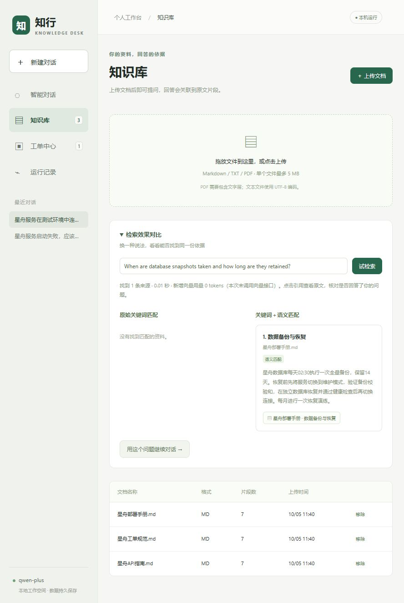

# v0.2 检索改进与实测

后续v0.3已完成候选重排与答案分项评测；最新实现、成本和人工复核见[排序与答案质量报告](RANKING_AND_ANSWER_QUALITY.md)。本文保留第二轮历史结果。

这一版把原始 BM25 扩展为可配置的关键词与语义混合检索，并补上缓存、故障降级和对比界面。目标是处理文档术语之外的口语、英文和缩写，而不是只让已有的直白 FAQ 继续满分。

## 实现

- 关键词路径增加 Unicode NFKC 归一化、HTTP 错误码识别及运维同义词扩展。扩展词权重为 0.35，原词权重为 1；原始 BM25 仍可作为评测基线。
- 通过现有千问配置真实调用 `text-embedding-v4` 的 `/embeddings` 接口，使用 256 维向量、每批最多 10 条输入。向量逐元素检查维度、数值类型、有限性和非零范数，归一化后计算余弦相似度。
- 对两路各最多 12 个候选执行 RRF，公式为 `Σ 1 / (60 + rank)`；应用取前 4 个片段，评测和预览查看前 3 个。RRF 分数不表示回答可信度。
- 文档缓存关联原始 chunk，删除文档时级联删除向量。查询缓存只保存文本哈希和向量，每个所属空间、模型配置最多 256 条；缓存命中复用向量，当前淘汰按写入时间，而非 LRU。
- 命名空间包含接口、模型、维度和预处理版本，所属空间单独作为缓存键。切换模型或维度会重新计算；不同浏览器空间不共享缓存。并发向量准备由锁串行化，减少同一进程的重复向量调用。
- 向量故障保留关键词结果，返回真实 `keyword` 模式及降级原因，30 秒内暂停再次调用。检索用量及模式记录到图事件；预览调用不创建运行任务，用量直接显示在预览中。
- 知识库加入可打开原文的两列对比，并可将同一问题转到对话。保留 `RETRIEVAL_MODE=keyword`，便于复查精确匹配场景。

接口约束参考 [阿里云向量 API 文档](https://help.aliyun.com/zh/model-studio/text-embedding-synchronous-api)，排名公式参考 [Elastic RRF 文档](https://www.elastic.co/docs/reference/elasticsearch/rest-apis/reciprocal-rank-fusion)。代码没有使用 Elasticsearch；RRF 在本地实现。

## 数据和选择流程

共 132 条自编问题：原有 FAQ 60 条；新挑战集包含 54 条改写正例、12 条无关问题、6 条主题相关但缺少具体答案的问题。挑战正例每个章节 3 条，前 2 条进入开发集，第 3 条进入固定验证集；这不是第三方独立数据或严格盲测。

在修改检索实现前，已保存 [旧版挑战集结果](reports/challenge-baseline.json)。数据集固定后，开发集从 0.45、0.50、0.55、0.60、0.65、0.70、0.75 中选择阈值：最大化 Hit@3 与无关问题拒绝率的均值，平局比较 MRR，再取较大阈值。选中 0.45，并成为应用默认值；未使用验证集选择阈值。词典为人工设计，仍可能带来开发偏差。

逐题报告保留所有正例、负例与失败案例，数据内容 SHA-256 为 `44ae005e4548051a907d1f84534f2150e5b563ad0f3103f40819bb6567697a5f`。模型返回向量不保证不同日期完全一致，可用持久缓存复查本次排名。

## 检索结果

| 分组与指标 | 原始 BM25 | 同义词 BM25 | 语义检索 | 混合检索 |
| --- | ---: | ---: | ---: | ---: |
| FAQ 正例 54 条 Hit@3 | 100.0% | 100.0% | 92.6% | 94.4% |
| 开发正例 36 条 Hit@3 | 27.8% | 52.8% | 94.4% | 94.4% |
| 验证正例 18 条 Hit@3 | 61.1% | 66.7% | 94.4% | 94.4% |
| 验证正例 Hit@1 | 38.9% | 38.9% | 83.3% | 66.7% |
| 验证正例 MRR@3 | 0.481 | 0.509 | 0.889 | 0.796 |
| 开发无关问题 8 条拒绝率 | 87.5% | 87.5% | 100.0% | 87.5% |
| 验证无关问题 4 条拒绝率 | 100.0% | 100.0% | 100.0% | 100.0% |

Hit@3 的命中定义是前三个片段至少一个属于标注章节；它不衡量回答质量。验证正例命中数从 11/18 增至 17/18，即提高 33.3 个百分点，但验证集较小且自编，不能外推为业务整体收益。

混合检索并非处处优于单路：在本次验证集上，纯语义的 Hit@1 和 MRR 高于混合；原 FAQ 中 3 条“工单重试”问题从前三条中丢失。关键词和语义的多个中等匹配在 RRF 中累加，可能挤掉单路很强的来源。原始关键词还把“电影盗梦空间”中的“空间”匹配到了工作空间限流。六条相近但无具体答案的问题只记录检索来源，不把“检索到相关主题”直接判成幻觉，另用实际回答检查拒答。

完整记录：[hybrid.json](reports/hybrid.json)、[同义词对照](reports/retrieval-v2.json)。这些回退案例应继续保留为回归数据，后续可检验语义重排或词项覆盖策略，不能靠隐藏失败案例宣称全面提升。

## 缓存与真实回答

首次检索评测为 21 个文档片段和 132 个问题向量化，共 17 次请求，接口报告 2731 tokens，总准备耗时 3.835 秒。重新启动评测进程后，153 个缓存条目全部命中，新增向量调用和用量均为 0。热缓存报告中 10 次本地查询 P95 为 30 ms，仅包含缓存读取与排名；它不包含模型回答、网络或首次索引，不能写成端到端延迟。

缓存复查见 [hybrid-warm.json](reports/hybrid-warm.json)。缓存向量保存在 `data/retrieval-eval.sqlite`；这份数据库只包含自编评测资料，与网页业务库分开。

另做了 6 条真实 `qwen-plus` 回答检查：3 条口语或英文问题返回正确的示例数值及引用；赔偿金额、备份密码和意大利面 3 条无依据问题均拒答。关键词规则检查 6/6 通过，经原文复核；本次 RAG 用量 7867 tokens，P95 为 4.224 秒。仅六条示例，数值不代表综合准确率或稳定性能。逐题文本和无检索对照见 [challenge-answers.json](reports/challenge-answers.json)。

## 工程验证

27 项自动化测试通过。新增测试覆盖真实向量接口的响应排序协议（使用 MockTransport）、非法向量、服务错误脱敏、损坏缓存修复、模型命名空间切换、向量删除级联、跨所属空间隔离、缓存配额、RRF 去重、服务降级冷却和检索预览输入校验。原审批、取消、跨重启恢复与写入后故障幂等测试均继续通过。

网页测试另验证：原业务会话和工单升级后保留；新的英文问题 `When are database snapshots taken and how long are they retained?` 原始关键词无命中、语义路径找到备份原文；重复预览新增向量用量为0；转入对话返回02:30与14天并带引用。390×844尺寸下没有横向溢出，检索结果正常堆叠，测试后恢复默认视口。手机截图见 [retrieval-mobile.jpg](reports/retrieval-mobile.jpg)。

## 简历描述素材

> 实现 BM25 与千问文本向量的混合检索，采用 RRF 融合来源排名；设计按工作空间及模型配置隔离的持久向量缓存、故障降级和检索对比界面。构建 132 条自编评测与固定开发/验证划分，在 18 条改写验证问题上将 Hit@3 从 61.1% 提升到 94.4%，并记录原 FAQ 的检索回退；完成 27 项工作流和检索测试。

应按自己实际理解和参与程度使用这些素材。面试时能解释“为什么 RRF 未必比纯向量好”“为什么相关片段不一定含有答案”“缓存如何在模型切换和文档删除后保持一致”，比只背 94.4% 更能体现判断力。
